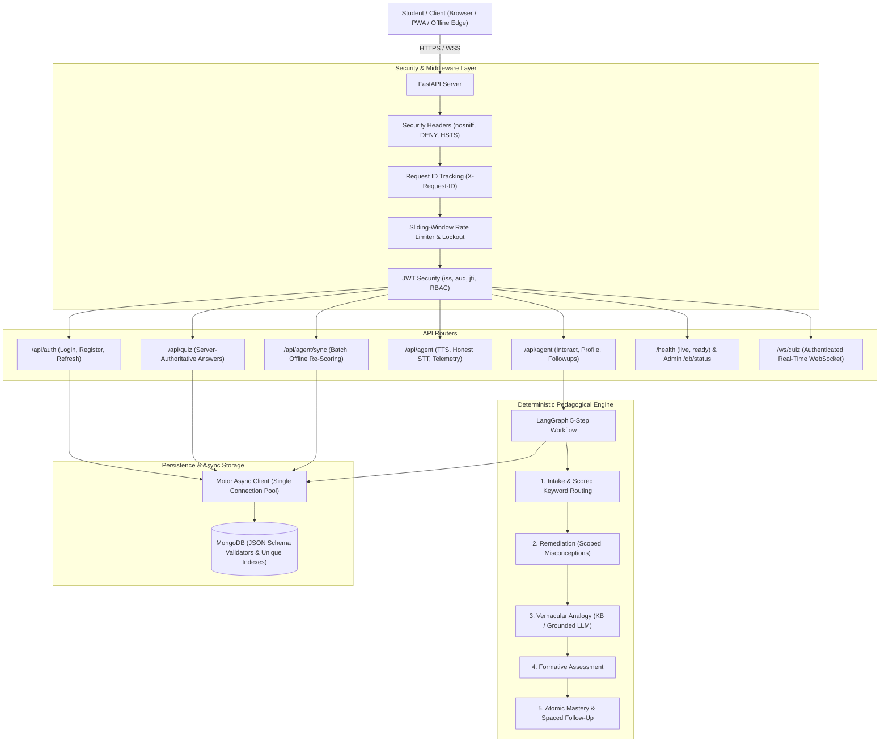

# EkalSahayak (Lakshya AI) Backend

Production-grade, vernacular-first agentic EdTech backend designed for rural Class 9 and 10 students in Odisha. Built with **FastAPI**, **LangGraph**, and **MongoDB (Motor)**, hardened against security vulnerabilities, race conditions, and cheating.

---

## 1. System Architecture



---

## 2. Quickstart Setup (5 Commands)

```bash
# 1. Create and activate Python 3.12 virtual environment
python -m venv .venv
source .venv/bin/activate  # On Windows: .venv\Scripts\activate

# 2. Install pinned dependencies (including development and testing tools)
pip install -r requirements-dev.txt

# 3. Configure environment file
cp .env.example .env

# 4. Generate a cryptographically secure 48-byte token for JWT_SECRET_KEY
python -c "import secrets; print('JWT_SECRET_KEY=' + secrets.token_urlsafe(48))" >> .env

# 5. Start the backend with live reload
uvicorn app.main:app --host 0.0.0.0 --port 8000 --reload
```

Or deploy immediately via Docker Compose:
```bash
docker compose up --build -d
```

---

## 3. Environment Variables Reference

| Variable | Type | Default | Description |
|---|---|---|---|
| `ENV` | `string` | `dev` | Mode (`dev` or `prod`). In `prod`, requires ≥32 char secret, non-empty CORS without `*`, and disables demo seed. |
| `JWT_SECRET_KEY` | `string` | *required* | Cryptographic secret for signing tokens. Must be ≥32 characters. |
| `JWT_ALGORITHM` | `string` | `HS256` | JWT algorithm strictly verified against header injection. |
| `ACCESS_TOKEN_EXPIRE_MINUTES` | `int` | `60` | Access token lifespan. |
| `REFRESH_TOKEN_EXPIRE_DAYS` | `int` | `7` | Refresh token duration before rotation. |
| `CORS_ORIGINS` | `list/csv` | `http://localhost:5173,...` | Whitelisted frontend origins. Wildcard `*` rejected in production. |
| `MONGODB_URI` | `string` | `mongodb://localhost:27017` | Async MongoDB Motor connection URI. |
| `MONGODB_DB_NAME` | `string` | `ekalsahayak` | Primary database name. |
| `SEED_DEMO` | `bool` | `true` | Seeds sample Class 9 student profile (dev mode only). |
| `TTS_CACHE_DIR` | `string` | `audio_cache` | Path for disk-cached synthesized voice files. |
| `STT_PROVIDER` | `string` | `null` | ASR provider (`null`, `whisper`, `bhashini`). |
| `GROQ_API_KEY` | `string` | `""` | Optional API key for Groq vernacular reasoning. |
| `GEMINI_API_KEY` | `string` | `""` | Optional API key for Google Gemini vernacular reasoning. |
| `OPENAI_API_KEY` | `string` | `""` | Optional API key for OpenAI vernacular reasoning. |

---

## 4. API Specification & Authorization Matrix

| Method | Endpoint | Auth Required | Role | Rate Limit | Description |
|---|---|---|---|---|---|
| `GET` | `/health/live` | No | Any | None | Fast process heartbeat. |
| `GET` | `/health/ready` | No | Any | None | MongoDB ping with 1s timeout (fails fast). |
| `POST` | `/api/auth/register` | No | Any | 5/min/IP | User registration (atomic profile rollback). |
| `POST` | `/api/auth/login` | No | Any | 5/min/IP | Login with 10-attempt / 15-min lockout. |
| `POST` | `/api/auth/refresh` | No | Any | 10/min/IP | Refresh token rotation with JTI revocation. |
| `POST` | `/api/auth/logout` | Yes | Student+ | None | Revokes active refresh token. |
| `POST` | `/api/agent/interact` | Yes (Bearer) | Student+ | 20/min/user | Runs 5-step LangGraph reasoning engine. |
| `GET` | `/api/agent/profile` | Yes (Bearer) | Student+ | 60/min/user | Retrieves student mastery and misconceptions. |
| `GET` | `/api/agent/followups` | Yes (Bearer) | Student+ | 60/min/user | Retrieves due spaced repetition items. |
| `GET` | `/api/agent/offline-pack` | Yes (Bearer) | Student+ | 10/min/user | Compact (<80 KB) offline curriculum bundle. |
| `POST` | `/api/agent/sync` | Yes (Bearer) | Student+ | 20/min/user | Offline batch sync with server-side scoring. |
| `GET` | `/api/quiz/topics` | Yes (Bearer) | Student+ | 60/min/user | Available curriculum drill topics. |
| `GET` | `/api/quiz/questions` | Yes (Bearer) | Student+ | 60/min/user | Public questions (correct answers omitted). |
| `POST` | `/api/quiz/answer` | Yes (Bearer) | Student+ | 30/min/user | Server-authoritative answer scoring. |
| `POST` | `/api/agent/quiz-submit`| Yes (Bearer) | Student+ | 30/min/user | Compatible server-authoritative submission alias. |
| `GET` | `/api/quiz/history` | Yes (Bearer) | Student+ | 60/min/user | Student's authenticated attempt history. |
| `POST` | `/api/agent/tts` | Yes (Bearer) | Student+ | 10/min/user | High-speed TTS with SHA-256 caching. |
| `POST` | `/api/agent/stt` | Yes (Bearer) | Student+ | 10/min/user | Audio transcription or 501 if unconfigured. |
| `GET` | `/api/agent/voice/samples` | Yes (Bearer) | Student+ | 60/min/user | Pre-recorded demo audio prompts. |
| `GET` | `/api/agent/voice/telemetry` | Yes (Bearer) | Admin | None | Voice cache hits and latency statistics. |
| `GET` | `/api/agent/traces` | Yes (Bearer) | Admin | None | Audit log of LangGraph execution traces. |
| `GET` | `/api/db/status` | Yes (Bearer) | Admin | None | Collection statistics and index health. |
| `GET` | `/metrics` | Yes (Bearer) | Admin | None | Prometheus telemetry metrics. |
| `WSS` | `/ws/quiz` | Query `?token=` | Student+ | Throttled | Real-time quiz session (max 1 active). |

---

## 5. Security & Anti-Cheat Architecture

1. **Token-Authoritative Identity**: The `student_id` is never accepted from request bodies or URL queries. Identity is derived strictly from verified JWT claims (`sub`), preventing IDOR attacks.
2. **Server-Authoritative Anti-Cheat**: Questions served to clients strictly omit `correct_index`. Client answers are checked server-side. Client-supplied scores in offline sync are strictly forbidden and rejected via Pydantic `extra="forbid"`.
3. **Mastery Gain Caps**: Mastery cannot be farmed; daily mastery increase is capped at `+0.30/day` per topic using atomic `$inc` clamped to `[0.0, 1.0]`.
4. **Timing-Safe Authentication**: Passwords use bcrypt cost 12. Constant-time comparisons and dummy hash operations ensure identical response latency for nonexistent usernames vs invalid passwords.
5. **Fail-Fast Production Safeguards**: In `ENV=prod`, the backend refuses to start if `JWT_SECRET_KEY` is weak (<32 characters), if default development secrets are detected, or if CORS contains `*`.

---

## 6. How to Run Verification & Tests

```bash
# Run complete test suite with coverage
pytest --cov=app --cov-report=term-missing --cov-fail-under=80

# Run Ruff linter
ruff check app tests

# Run Mypy static type checker
mypy app

# Run Bandit security audit
bandit -r app -ll
```

---

## 7. Enabling Optional Real AI Providers

### Speech-to-Text (ASR)
- Default behavior: `STT_PROVIDER=null` returns an honest HTTP 501 with `{ "code": "stt_not_configured" }`.
- Whisper: Set `STT_PROVIDER=whisper` and provide `OPENAI_API_KEY`.
- Bhashini ULCA: Set `STT_PROVIDER=bhashini`, `BHASHINI_API_KEY`, and `BHASHINI_USER_ID`.

### Large Language Model (Vernacular Reasoning)
- Default behavior: Deterministic pedagogical knowledge base with Odia analogies.
- LLM Enhancement: Set `GROQ_API_KEY` (or `GEMINI_API_KEY` or `OPENAI_API_KEY`). The engine dynamically rewrites answers into simplified Odia, enforces strict grounding, checks for Odia script ratio (>0.40), sanitizes prompt injection attempts, and enforces a 4-second timeout before falling back safely to deterministic KB text.

---

## 8. Honest Disclosures & Known Limitations

- **Odia TTS Approximation**: Standard gTTS does not have native Odia voice models, so Odia text is synthesized via Hindi phonetics as an acoustic approximation.
- **In-Memory Rate Limiting**: The built-in rate limiter uses an in-memory sliding window. Multi-replica deployments should back the `AbstractRateLimiter` interface with Redis.
