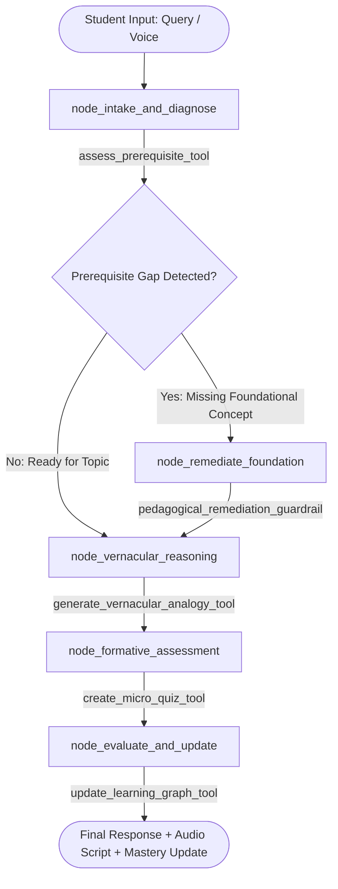
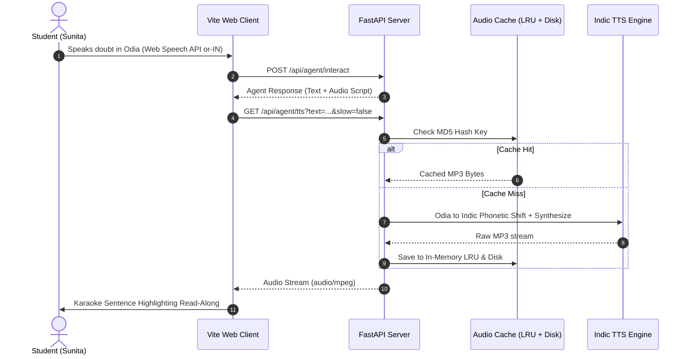
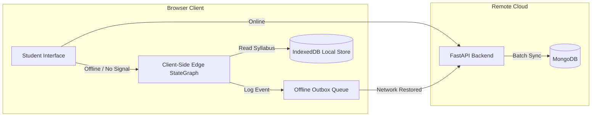

# EkalSahayak (Sunita AI) - System Architecture Specification

## 1. Executive Architecture Overview

**EkalSahayak (Sunita AI)** is an agentic, vernacular-first EdTech platform engineered specifically for Class 9 and 10 students in rural and tribal Odisha (following the BSE Odisha State Board syllabus). 

The platform addresses three structural constraints prevalent in rural education:
1. **Cognitive & Vernacular Barrier**: Traditional education software relies on dense textbook English or formal Odia. EkalSahayak uses a voice-first, dialect-aware Indic acoustic engine with local cultural anchors (*ମାଟି ମାଠିଆ*, *ଭାତ ହାଣ୍ଡି*, *ସାପ୍ତାହିକ ହାଟ*).
2. **Infrastructure Asymmetry**: Students often share a single low-end smartphone within a family with only 1 hour of daily access and intermittent 2G/3G connectivity. The system is architected as an **Offline-First Edge Agent** with micro-payloads (<80 KB) cached locally via IndexedDB.
3. **Pedagogical Reliability (Anti-Hallucination)**: LLM chatbots frequently hallucinate or skip conceptual prerequisites when answering student doubts. EkalSahayak employs a **Deterministic LangGraph State Machine** where pedagogical steps (prerequisite checks, foundation remediation, analogy reasoning, and formative micro-quizzes) are mathematically bounded and fully auditable.

```
+-----------------------------------------------------------------------------------------+
|                                    CLIENT LAYER                                         |
|  +--------------------+  +----------------------+  +---------------------------------+  |
|  |  Voice Odia STT    |  |  Odia Read-Along     |  |   Real-Time WebSocket Quiz UI   |  |
|  |  (Web Speech API)  |  |  Karaoke Player      |  |   (/ws/quiz - 30s timers)       |  |
|  +--------------------+  +----------------------+  +---------------------------------+  |
|  +-----------------------------------------------------------------------------------+  |
|  |            IndexedDB Offline Edge Agent & Outbox Queue (Offline Cache < 80 KB)     |  |
|  +-----------------------------------------------------------------------------------+  |
+-------------------------------------------|---------------------------------------------+
                                            | HTTP REST / WebSocket (JSON)
                                            v
+-----------------------------------------------------------------------------------------+
|                                  APPLICATION GATEWAY                                    |
|                      FastAPI Server (Python 3.12, Uvicorn, ASGI)                         |
|  +-----------------------+  +----------------------+  +------------------------------+  |
|  |  JWT Authentication   |  |  Voice Synthesis     |  |  Offline Sync & Outbox Batch |  |
|  |  & User RBAC          |  |  & Transliteration   |  |  Reconciliation              |  |
|  +-----------------------+  +----------------------+  +------------------------------+  |
+-------------------------------------------|---------------------------------------------+
                                            v
+-----------------------------------------------------------------------------------------+
|                                  AGENTIC BRAIN LAYER                                    |
|                       Deterministic LangGraph Workflow Engine                           |
|                                                                                         |
|  [Intake & Prerequisite] -> (Prereq Missing?) --[Yes]--> [Remediate Foundation]        |
|                                     |                             |                     |
|                                  [No]                             v                     |
|                                     +---------------> [Vernacular Reasoning]            |
|                                                               |                         |
|                                                               v                         |
|                                                   [Formative Assessment]                |
|                                                               |                         |
|                                                               v                         |
|                                                   [Evaluate & Mastery Update]           |
+-------------------------------------------|---------------------------------------------+
                                            v
+-----------------------------------------------------------------------------------------+
|                                   DATA & STORAGE                                        |
|  +----------------------------------------+  +---------------------------------------+  |
|  |  MongoDB Motor (Async)                 |  |  BSE Odisha Curriculum Knowledge Base |  |
|  |  - User Credentials (bcrypt)           |  |  - Concept Maps & Misconception DB    |  |
|  |  - Mastery Graph (Retention Tracking)  |  |  - Seed Questions & Odia Explanations |  |
|  |  - Quiz Telemetry & Traces             |  |  - Rural Cultural Anchors             |  |
|  +----------------------------------------+  +---------------------------------------+  |
+-----------------------------------------------------------------------------------------+
```

---

## 2. Core Architectural Subsystems

### 2.1 Deterministic Pedagogical LangGraph Engine

Pedagogy requires reproducible guardrails. Rather than an autonomous ReAct loop that can spiral into hallucinations or fail to cover prerequisites, EkalSahayak runs a **Directed Acyclic State Graph (`StateGraph`)** implemented with `langgraph` and `langchain`.

#### State Graph Definition (`AgentState`)
```python
class AgentState(TypedDict):
    student_id: str               # Unique learner handle
    query: str                    # Student question in Odia or English
    language: str                 # "odia" (default) | "english"
    input_type: str               # "text" | "voice"
    is_offline: bool              # Online vs Edge offline execution
    detected_topic: str           # E.g., "evaporation", "latent_heat", "cell_biology"
    student_profile: Dict[str, Any] # Current mastery scores & misconceptions
    prerequisite_missing: bool    # True if foundational gap flagged
    prerequisite_topic: Optional[str]
    misconception_diagnosed: Optional[str]
    vernacular_analogy: Optional[Dict[str, Any]]
    micro_quiz: Optional[List[Dict[str, Any]]]
    updated_mastery: Optional[Dict[str, Any]]
    final_response_odia: str
    final_audio_script: str
    next_followup_plan: str
    traces: List[Dict[str, Any]]  # Step-by-step decision telemetry
    current_node: str
```

#### Node Sequence & Transition Logic



1. **`node_intake_and_diagnose`**:
   - Parses the student query using regex keyword mappings and curriculum classification.
   - Evaluates prerequisite mastery (e.g., student asking about *Evaporation* is checked for understanding of *States of Matter* and *Latent Heat*).
   - Diagnoses common conceptual traps (e.g., confusing Evaporation with Boiling point 100°C).
2. **`node_remediate_foundation`**:
   - Executes if `prerequisite_missing == True`.
   - Injects a bite-sized scaffolding explanation before addressing the advanced query.
3. **`node_vernacular_reasoning`**:
   - Anchors scientific phenomena in authentic rural Odisha daily life:
     - **Evaporation & Latent Heat**: Earthen pot (*ମାଟି ମାଠିଆ*), sweat cooling, wet clothes on clotheslines.
     - **Steam vs Boiling Water**: Burning intensity of steam from a rice boiling pot (*ଭାତ ହାଣ୍ଡି ଭାପ*).
     - **Cell Biology**: Mitochondria compared to village rice mill engine (*ଧାନ କଳ ଇଞ୍ଜିନ*).
4. **`node_formative_assessment`**:
   - Emits exactly 2 micro-quiz questions tailored to the diagnosed concept.
5. **`node_evaluate_and_update`**:
   - Updates student retention score and mastery percentage.
   - Computes an automated next-day study nudge (e.g., tomorrow at 6:00 PM).

---

### 2.2 Voice & Vernacular Odia Layer

Rural Class 9 students experience significant screen fatigue when forced to read scientific Odia paragraphs with complex conjunct letters (*ଯୁକ୍ତାକ୍ଷର*) on small 5-inch smartphone screens.

#### Phonetic Transliteration Pipeline
Standard browser Text-to-Speech (TTS) engines have no native voice model for Odia (`or-IN`). EkalSahayak features a custom phonetic mapper:
- Shifts Odia Unicode block (`U+0B00` to `U+0B7F`) into relative Brahmi Indic Devanagari phonemes (`U+0900` to `U+097F`).
- Special cases handle distinct Odia consonants:
  - `ଡ଼ (U+0B5C)` -> `ड़ (U+095C)` (Rra)
  - `ଢ଼ (U+0B5D)` -> `ढ़ (U+095D)` (Rha)
  - `ୟ (U+0B5F)` -> `य (U+092F)` (Ya)
  - `ୱ (U+0B71)` -> `व (U+0935)` (Wa)
  - Odia numerals (`୦-୯`) mapped to standard Indic numerals (`०-९`).
- Generates natural, cadence-accurate audio via Google TTS / Bhashini pipeline.
- Implements a dual-tier caching strategy (In-Memory LRU + Disk cache in `.audio_cache`) to minimize rural mobile bandwidth consumption.



---

### 2.3 Edge Offline-First Layer (IndexedDB + Outbox Sync)

In rural Odisha, network availability is intermittent. EkalSahayak operates under a **Zero-Data Offline Execution Model**:



1. **Pre-Caching (<80 KB Payload)**:
   - Complete BSE Odisha Class 9 Science Units (Matter, Cells, Motion) are serialized and cached in client `IndexedDB` on first visit.
2. **Client-Side Edge StateGraph**:
   - If `navigator.onLine === false` or server ping fails, `agent-client.ts` executes the LangGraph workflow directly in browser JavaScript memory using the local IndexedDB syllabus cache.
3. **Outbox Event Queue**:
   - Offline quiz submissions and doubt traces are staged into the `offline_outbox` store with client UUIDs and timestamps.
4. **Auto-Reconnection Sync**:
   - `window.addEventListener('online')` triggers `syncOfflineOutbox()`, batch-posting queued actions to `/api/agent/sync`.

---

### 2.4 Real-Time WebSocket Questionnaire Engine (`/ws/quiz`)

The live quiz module provides engaging, high-speed formative micro-assessments:
- **Connection**: `ws://<host>/ws/quiz?token=<jwt>&topic=<topic>&difficulty=<level>`
- **Live 30-Second Timers**: Synchronized countdown per question with server-side expiry enforcement.
- **Pedagogical Hints**: Triggered automatically when 10 seconds remain on the countdown.
- **Streak Multipliers**: 3 consecutive correct answers trigger streak bonuses (+25% mastery boost).
- **Mastery Graph Persistence**: Results immediately update the student's mastery profile in MongoDB.

---

### 2.5 Judge Inspector Mode (Live Telemetry & Auditability)

A prominent requirement for evaluation and pedagogical compliance is transparent decision inspection:
- **Slide-out Drawer**: Accessible directly from the top navigation bar.
- **Live Step Counter**: Dynamic badge showing exact execution depth (e.g., 5 steps).
- **Thought-Action-Observation Cards**:
  - **Thought**: Internal reasoning (e.g., *"Student confused Evaporation with Boiling; requires Latent Heat grounding"*).
  - **Tool Called**: Explicit tool name and parameters (e.g., `assess_prerequisite_tool(concept="states_of_matter")`).
  - **Observation**: Output returned by the pedagogical tool.
- **Raw JSON Inspector**: Full JSON payload for technical verification.
- **Voice Engine Telemetry**: STT confidence score, TTS cache hit ratio, and phonetic transliteration inspection.
- **Pedagogical Defense Rubric**: Structural rationale contrasting deterministic state machines against unconstrained LLM loops.

---

## 3. Database Schema (MongoDB & Motor Async)

The persistent storage tier uses MongoDB with Motor async driver and PyMongo sync fallback:

```
+-----------------------------------------------------------------------------------------+
|                                    MONGODB COLLECTIONS                                  |
+-----------------------------------------------------------------------------------------+

1. Collection: `users`
   - _id: ObjectId
   - email: String (unique index)
   - username: String
   - password_hash: String (bcrypt)
   - grade: String ("Class 9" | "Class 10")
   - language: String ("odia" | "english")
   - role: String ("student" | "teacher" | "evaluator")
   - created_at: DateTime

2. Collection: `student_profiles`
   - _id: ObjectId
   - student_id: String (unique index)
   - mastery_graph: Object
       { "evaporation": 0.85, "latent_heat": 0.70, "cell_biology": 0.40 }
   - retention_scores: Object
       { "evaporation": 0.92, "cell_biology": 0.55 }
   - known_misconceptions: Array of Strings
   - scheduled_nudges: Array of Objects
       [{ "topic": "evaporation", "scheduled_time": "2026-10-15T18:00:00Z" }]
   - last_active: DateTime

3. Collection: `questions`
   - _id: ObjectId
   - id: String (unique index, e.g., "q_evap_01")
   - topic: String ("evaporation" | "latent_heat" | "cell_biology")
   - difficulty: String ("easy" | "medium" | "hard")
   - prompt_odia: String
   - prompt_english: String
   - options_odia: Array of Strings
   - options_english: Array of Strings
   - correct_index: Integer (0-3)
   - explanation_odia: String
   - explanation_english: String
   - prerequisite: String

4. Collection: `quiz_sessions`
   - _id: ObjectId
   - session_id: String (UUID)
   - student_id: String
   - topic: String
   - score: Integer
   - total_questions: Integer
   - streak_max: Integer
   - answers: Array of Objects
       [{ "question_id": "q_evap_01", "selected": 0, "correct": true, "time_spent_ms": 4200 }]
   - completed_at: DateTime
```

---

## 4. Security & Environment Configuration

- **JWT Authentication**: Tokens signed with `HS256`, 30-day expiry (`ACCESS_TOKEN_EXPIRE_MINUTES=43200`) to avoid frequent re-logins on shared rural phones.
- **Passwords**: Hashed with salted bcrypt (`rounds=12`).
- **CORS**: Explicit origins with credentials support for Vite dev server and production deployments.
- **API Resilience**: If MongoDB is unreachable on cold boot, the server logs a warning and falls back to an in-memory knowledge store without crashing.
