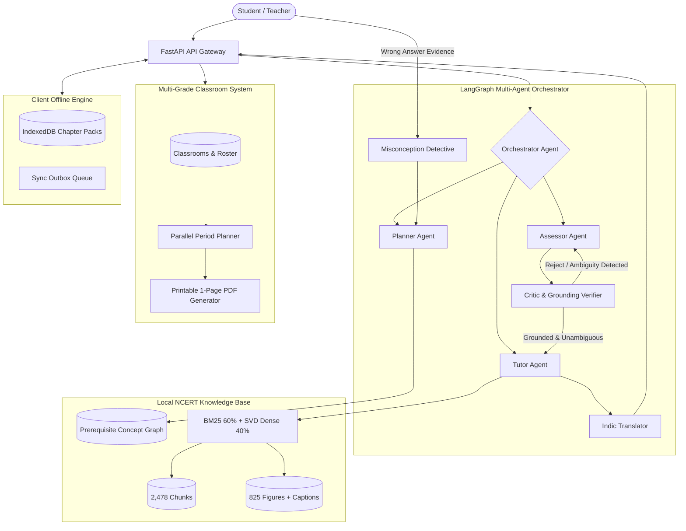

# EkalSahayak (Lakshya AI) - Multi-Agent Architecture

## System Overview

EkalSahayak utilizes an offline-first, grounded multi-agent pipeline designed for rural Indian classrooms where internet connectivity is intermittent and compute resources are limited.

---

## Agent Roles and Responsibilities

### 1. Orchestrator Agent (`agent/app/agent/nodes.py`)
- **Mission:** Primary request router and failure recovery engine.
- **Fail-Safe Mechanism:** Evaluates query relevance before retrieval. If a query is outside the NCERT curriculum boundaries (e.g., current affairs, college calculus), triggers `not_found` with nearest recommended chapters without hallucinating.

### 2. Planner Agent (`agent/app/services/planner_service.py`)
- **Mission:** Generates daily personalized study plans.
- **Inputs:** Student's real mastery graph, prerequisite concept dependencies, active misconception triggers, time budget (30/45/60 min), and spaced repetition intervals.
- **Output:** Structured items (`learn`, `check`, `review`, `practice`) with honest status (`not_started`). A new user without a diagnostic cannot receive a plan.

### 3. Tutor Agent (`agent/app/services/lesson_service.py`)
- **Mission:** Generates structured 8-block interactive lessons grounded in NCERT textbooks.
- **Structure:**
  1. *Hook Question:* Real-world curiosity prompt.
  2. *Plain-Language Explanation:* Grade 9 reading level with exact citation.
  3. *Rural Context Analogy:* Indian village examples (e.g., earthen pot cooling, bullock cart momentum).
  4. *Worked Activity:* Textbook practical activity.
  5. *Book Figure:* Actual diagram with caption and page reference.
  6. *Key Terms:* Bilingual vocabulary with English in brackets.
  7. *Check Yourself:* 2–3 inline formative questions.
  8. *Summary Cards:* Key takeaway synthesis.
- **"Samajh nahi aaya" Handler:** Re-explains using everyday metaphors on attempt 1; directs to prerequisite concept on attempt 2.

### 4. Assessor Agent (`agent/app/services/diagnostic_service.py`, `quiz_service.py`)
- **Mission:** Generates diagnostic, quiz, and practice questions strictly from retrieved chunks.
- **Integrity:** Correct answers and misconception mapping are stored server-side.

### 5. Critic & Grounding Verifier (`agent/app/agent/nodes.py`)
- **Mission:** Quality control gatekeeper for generated content.
- **Validation Checklist:**
  - Strict grounding: Is every assertion backed by textbook chunk citations?
  - Single unambiguous correct answer.
  - Grade 9 appropriate vocabulary.
  - If rejected, triggers regeneration (max 2 retries).

### 6. Misconception Detective (`agent/app/services/mastery_service.py`)
- **Mission:** Diagnoses conceptual traps from wrong answers.
- **Behavior:** Never flags a misconception without tangible wrong-answer evidence. Stores tag, creates targeted review item, and updates teacher aggregate clusters.

### 7. Indic Translator (`agent/app/i18n/`)
- **Mission:** High-fidelity multilingual delivery across Tier A (Hindi, Odia, Hinglish, English) and Tier B (Assamese, Bengali, Gujarati, Kannada, etc.).
- **Science Term Rule:** Always preserves English technical terms in brackets (e.g., "वाष्पीकरण (Evaporation)", "କୋଷ (Cell)").

---

## Data Flow & Trace Inspector

Every agent action records a structured execution trace:
- `trace_id`: UUID4
- `agent`: Planner | Tutor | Assessor | Critic | Orchestrator
- `action`: tool invocation / generation step
- `retrieved_chunk_ids`: List of grounded chunk references
- `critic_verdict`: `APPROVED` | `REJECTED`
- `duration_ms`: Real execution time in milliseconds

Traces are visible in the **Agent Trace Inspector** modal in the frontend for live auditability.
